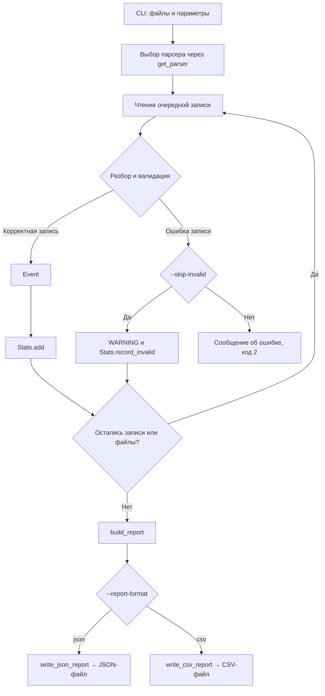

# Лабораторная работа № 2: Потоковый анализатор файлов

## Цель работы

Цель лабораторной работы — реализовать пакет `streamstats`, который читает события из CSV и JSONL, проверяет входные данные и формирует статистический отчёт. При выполнении работы используются генераторы, собственные исключения, классы данных и интерфейс командной строки. Дополнительно реализованы реестр функций-парсеров и сохранение отчёта в CSV без повторного расчёта статистики.

Программа обрабатывает записи последовательно. После проверки событие сразу учитывается в статистике, поэтому сохранять весь входной файл в памяти не требуется.

## Результат работы

В текущей версии реализованы:

- чтение JSONL и CSV с заголовком;
- проверка обязательных полей, типов значений, уровня события и источника;
- преобразование временных меток в UTC;
- подсчёт корректных событий, событий каждого уровня и каждого источника;
- подсчёт ошибок уровней `ERROR` и `CRITICAL` с выбором top-5 источников;
- поиск самой ранней и самой поздней временных меток;
- обработка нескольких файлов одного формата с общим отчётом;
- остановка при ошибке или пропуск повреждённой записи через `--skip-invalid`;
- регистрация парсеров по имени формата через общий реестр;
- сохранение результатов в JSON или CSV без дублирования расчётов;
- проверки кода через pre-commit, mypy и Ruff.

README описывает текущее поведение программы. Оставшиеся проверки и доработки перечислены в разделе «Что осталось завершить».

## Структура проекта

```text
Python_lab2_Streamfileanalyzer/
├── pyproject.toml                 # Требования к Python, зависимости и настройки mypy
├── .pre-commit-config.yaml        # Проверки перед коммитом
├── README.md
├── src/
│   ├── __init__.py
│   ├── streamstats/
│   │   ├── __init__.py
│   │   ├── __main__.py            # Аргументы CLI и запуск обработки
│   │   ├── models.py              # Event, проверка полей и разбор времени
│   │   ├── parsers.py             # Чтение JSONL и CSV
│   │   ├── registry.py            # Регистрация и поиск функций-парсеров
│   │   ├── analysis.py            # Накопление статистики в Stats
│   │   ├── report.py              # Подготовка отчёта, запись JSON и CSV
│   │   └── errors.py              # Собственные исключения
│   ├── check.jsonl               # 20 записей, включая одну с неверным source
│   ├── check_new.jsonl           # 5 корректных событий
│   ├── broken.jsonl              # 1 корректная и 4 повреждённые записи
│   ├── check_csv_1.csv           # 20 корректных событий
│   └── check_csv_2.csv           # Ещё 20 корректных событий
└── tests/
    └── __init__.py               # Каталог подготовлен; автотесты ещё не добавлены
```

## Подготовка окружения

В `pyproject.toml` указан Python **3.12 или новее**. Основная обработка реализована средствами стандартной библиотеки. Для будущих автоматических тестов в зависимости проекта добавлен `pytest`.

Команды ниже рассчитаны на macOS/Linux и выполняются из корня Git-репозитория — папки, в которой находятся `pyproject.toml`, `.pre-commit-config.yaml` и `src`.

Для подготовки окружения используется `uv`:

```bash
uv sync
source .venv/bin/activate
export PYTHONPATH="$PWD/src"
```

`uv sync` подготавливает окружение и устанавливает зависимости проекта. `PYTHONPATH` добавляет папку `src` в путь поиска модулей, чтобы запуск `python -m streamstats` работал из корня репозитория. При открытии нового терминала активацию окружения и установку `PYTHONPATH` нужно повторить. [Документация uv](https://docs.astral.sh/uv/guides/projects/).

Для проверки доступности программы:

```bash
python -m streamstats --help
python -m streamstats analyze --help
```

---

## Этап 1. Модель события и проверка данных

В модуле `models.py` создан класс `Event` с помощью `@dataclass(frozen=True)`. После создания события его поля не должны изменяться. Входные значения проверяет функция `validate_event()`, поскольку аннотации dataclass сами по себе не выполняют валидацию.

| Поле | Требование |
|---|---|
| `timestamp` | Строка с датой и временем, разбираемая `datetime.fromisoformat()` |
| `level` | Одно из значений: `DEBUG`, `INFO`, `WARNING`, `ERROR`, `CRITICAL` |
| `source` | Непустая строка; значение из одних пробелов отклоняется |
| `message` | Строка; пустое сообщение допускается |

Сначала проверяется наличие каждого поля, затем его тип. После этого проверяются допустимый уровень и непустой источник. Проверенные строки сохраняются в отдельный словарь `validated`, из которого создаётся `Event`.

Для временной метки используется `parse_timestamp()`. Значения с часовым поясом переводятся в UTC. Если пояс не указан, в проекте принято считать такое время UTC:

```text
2026-10-20T09:00:00+03:00 → 2026-10-20T06:00:00+00:00
2026-10-20T06:00:00      → 2026-10-20T06:00:00+00:00
```

Это правило позволяет сравнивать события из разных источников. Поддерживаются формы ISO 8601, которые принимает `datetime.fromisoformat()`; поддержка всех вариантов стандарта отдельно не реализована.

Документация: [dataclasses](https://docs.python.org/3/library/dataclasses.html), [datetime.fromisoformat](https://docs.python.org/3/library/datetime.html#datetime.datetime.fromisoformat).

## Этап 2. Чтение JSONL и CSV

### JSONL

В JSONL каждая строка содержит отдельный JSON-объект. Общий массив и запятые между записями не нужны:

```jsonl
{"timestamp":"2026-10-20T09:00:00+03:00","level":"INFO","source":"api","message":"Сервис запущен"}
{"timestamp":"2026-10-20T09:01:00+03:00","level":"ERROR","source":"database","message":"Ошибка подключения"}
```

Функция `parse_jsonl()` читает файл через `for line in f`, разбирает каждую строку с помощью `json.loads()` и передаёт словарь в `validate_event()`. Корректное событие выдаётся через `yield`.

Число, массив или `null` могут быть корректным JSON, но не подходят для события: парсер ожидает объект. Пустая строка также считается неверной JSON-записью. Полностью пустой JSONL-файл обрабатывается без ошибки и даёт нулевую статистику.

### CSV

В CSV первая строка содержит названия столбцов:

```csv
timestamp,level,source,message
2026-10-20T09:00:00+03:00,INFO,api,Сервис запущен
2026-10-20T09:01:00+03:00,ERROR,database,Ошибка подключения
```

Функция `parse_csv()` использует `csv.DictReader`. Он читает заголовок и выдаёт записи в виде словарей. Далее применяется та же `validate_event()`, что и для JSONL.

Все обязательные столбцы должны присутствовать. Заголовок не учитывается как событие. Если файл содержит только корректный заголовок, статистика будет пустой. Полностью пустой CSV в текущей версии отклоняется с сообщением об отсутствии заголовка.

Оба парсера используют UTF-8. Входной файл не загружается целиком через `read()` или `readlines()`.

Документация: [json](https://docs.python.org/3/library/json.html), [csv.DictReader](https://docs.python.org/3/library/csv.html#csv.DictReader), [генераторы Python](https://docs.python.org/3/tutorial/classes.html#generators).

### Реестр функций-парсеров

Для подключения новых форматов создан модуль `registry.py`. В словаре `PARSERS` хранится соответствие между именем формата и функцией, которая читает его записи:

```text
jsonl → parse_jsonl
csv   → parse_csv
```

Функция `register_parser(name, parser)` добавляет парсер в реестр. Повторная регистрация того же имени вызывает `ValueError`. Функция `get_parser(name)` возвращает зарегистрированную функцию или вызывает `UnsupportedFileFormatError`, если имя неизвестно.

Встроенные парсеры регистрируются в `__main__.py` до вызова `main()`:

```python
register_parser("jsonl", parse_jsonl)
register_parser("csv", parse_csv)
```

После разбора аргументов CLI выбирает функцию через реестр:

```python
parse_file = get_parser(args.format)
```

Допустимые значения `--format` формируются из `tuple(PARSERS)`. Поэтому при добавлении нового формата не требуется дописывать ветку выбора парсера в CLI.

Пользовательская функция должна поддерживать параметры `path`, `skip_invalid=False` и `on_invalid=None`, выдавать объекты `Event` и вызывать `on_invalid()` при пропуске неверной записи, если обработчик передан. После написания и импорта такой функции достаточно зарегистрировать её до разбора аргументов:

```python
# parse_custom — заранее написанная и импортированная функция.
register_parser("custom", parse_custom)
```

Это программное подключение: реестр не загружает внешние модули автоматически. В поставляемом наборе пока зарегистрированы только CSV и JSONL. Работоспособность регистрации дополнительной функции проверена отдельным запуском; полноценный третий файловый парсер в проект не добавлен.

## Этап 3. Обработка ошибок

В `errors.py` создана иерархия исключений:

```text
StreamStatsError
├── InvalidEventError
│   └── InvalidTimestampError
└── UnsupportedFileFormatError
```

`StreamStatsError` является базовой ошибкой пакета. `InvalidEventError` используется для некорректных событий, а `InvalidTimestampError` — при невозможности разобрать время. На границе парсера ошибка события дополняется путём к файлу и номером строки.

`UnsupportedFileFormatError` используется при поиске отсутствующего формата в реестре. При запуске через CLI неизвестное значение `--format` отклоняется ещё на этапе проверки аргументов `argparse`.

По умолчанию первая обнаруженная ошибка события останавливает обработку. CLI выводит сообщение в `stderr` и завершается с кодом `2`. Отчёт записывается только после успешного завершения обработки всех входных файлов.

С флагом `--skip-invalid` парсер записывает предупреждение уровня `WARNING`, вызывает переданный метод `stats.record_invalid()` и переходит к следующей записи. Корректные события при этом продолжают поступать в `Stats.add()`.

В текущей реализации `record_invalid()` дополнительно печатает в терминал сообщение `Skipped invalid event. Total skipped: ...`. Сам отчёт сохраняется в файл выбранного формата.

Ошибки открытия или записи файлов не пропускаются этим флагом. Отсутствие обязательного CSV-заголовка также останавливает обработку.

Документация: [исключения Python](https://docs.python.org/3/tutorial/errors.html), [logging](https://docs.python.org/3/library/logging.html).

## Этап 4. Накопление статистики

В `analysis.py` реализован dataclass `Stats`. Метод `add()` обновляет статистику после получения каждого корректного события.

Для количества событий по уровням и источникам используется `Counter`. Ошибки учитываются в отдельном счётчике `error_counts_by_source`, если уровень равен `ERROR` или `CRITICAL`. Метод `top_error_sources()` выбирает до пяти наиболее частых источников ошибок через `most_common()`.

Временные границы обновляются сравнением с каждым новым событием. Поэтому записи не требуется предварительно сортировать: `first_timestamp` содержит минимум, а `last_timestamp` — максимум.

При обработке нескольких файлов создаётся один объект `Stats`. События из каждого файла последовательно добавляются в него, после чего формируется общий отчёт.

Память расходуется на текущую запись и накопленные счётчики. Её объём зависит от размера записи и количества уникальных источников; строго постоянное потребление памяти не гарантируется.

Документация: [collections.Counter](https://docs.python.org/3/library/collections.html#collections.Counter).

## Этап 5. Формирование отчёта

В `report.py` подготовка данных отделена от формата записи:

- `build_report(stats)` создаёт словарь из уже рассчитанной статистики;
- `write_json_report(report, path)` сохраняет словарь в JSON;
- `write_csv_report(report, path)` записывает те же показатели в CSV.

Сначала один раз вызывается `build_report()`, затем выбирается функция записи. Оба формата используют готовые значения: повторное чтение событий, обновление счётчиков и вычисление top-5 не выполняются.

Для записи JSON используется `json.dump()` с `ensure_ascii=False` и `indent=2`. Благодаря этому кириллица остаётся читаемой, а JSON получает отступы.

| Поле отчёта | Содержание |
|---|---|
| `total_records` | Сумма корректных событий и пропущенных повреждённых записей |
| `total_events` | Количество корректных событий |
| `skipped_invalid` | Количество записей, пропущенных с `--skip-invalid` |
| `counts_by_level` | Количество событий каждого встреченного уровня |
| `counts_by_source` | Количество событий каждого источника |
| `error_counts_by_source` | Количество событий `ERROR` и `CRITICAL` по источникам |
| `first_timestamp` | Самая ранняя временная метка в UTC |
| `last_timestamp` | Самая поздняя временная метка в UTC |
| `top_error_sources` | До пяти пар `[источник, количество ошибок]` |

Повреждённые записи не включаются в `total_events` и остальные счётчики событий. При отсутствии корректных событий в JSON временные границы имеют значение `null`, словари счётчиков и список top-5 остаются пустыми. В CSV отсутствующая временная метка записывается как пустая ячейка.

`total_records` не является числом физических строк: CSV-запись может занимать несколько строк, а заголовок не считается событием.

### Пример JSON-отчёта

Для файла `src/check_new.jsonl` команда:

```bash
python -m streamstats analyze src/check_new.jsonl --format jsonl --output report.json
```

создаёт следующий отчёт:

```json
{
  "total_records": 5,
  "total_events": 5,
  "skipped_invalid": 0,
  "counts_by_level": {
    "INFO": 1,
    "DEBUG": 1,
    "WARNING": 1,
    "ERROR": 1,
    "CRITICAL": 1
  },
  "counts_by_source": {
    "api": 1,
    "auth": 1,
    "cache": 1,
    "database": 1,
    "monitor": 1
  },
  "error_counts_by_source": {
    "database": 1,
    "monitor": 1
  },
  "first_timestamp": "2026-10-20T13:00:00+00:00",
  "last_timestamp": "2026-10-20T13:05:00+00:00",
  "top_error_sources": [
    ["database", 1],
    ["monitor", 1]
  ]
}
```

### CSV-отчёт без дублирования расчётов

В CSV используется таблица из трёх столбцов: `section`, `key`, `value`. Первый обозначает раздел отчёта, второй — показатель, уровень или источник, третий — соответствующее значение.

Запись выполняется через `csv.writer()`. Файл открывается с `encoding="utf-8"` и `newline=""`. Вложенные словари разворачиваются в строки, а пары top-5 записываются в порядке, возвращённом анализатором.

Для того же входного файла:

```bash
python -m streamstats analyze src/check_new.jsonl --format jsonl --report-format csv --output report.csv
```

получается следующий CSV:

```csv
section,key,value
summary,total_records,5
summary,total_events,5
summary,skipped_invalid,0
counts_by_level,INFO,1
counts_by_level,DEBUG,1
counts_by_level,WARNING,1
counts_by_level,ERROR,1
counts_by_level,CRITICAL,1
counts_by_source,api,1
counts_by_source,auth,1
counts_by_source,cache,1
counts_by_source,database,1
counts_by_source,monitor,1
error_counts_by_source,database,1
error_counts_by_source,monitor,1
timestamps,first_timestamp,2026-10-20T13:00:00+00:00
timestamps,last_timestamp,2026-10-20T13:05:00+00:00
top_error_sources,database,1
top_error_sources,monitor,1
```

Таким образом, JSON и CSV содержат одинаковые показатели, но представляют их по-разному. Этот вариант выполняет дополнительное задание по CSV-отчёту без дублирования расчётов.

## Этап 6. Интерфейс командной строки

Точка входа расположена в `src/streamstats/__main__.py`. Аргументы разбираются через `argparse`.

```text
python -m streamstats analyze INPUT [INPUT ...] [--format {jsonl,csv}] [--report-format {json,csv}] [--output REPORT] [--skip-invalid]
```

| Аргумент | Назначение | Поведение по умолчанию |
|---|---|---|
| `INPUT` | Один или несколько путей к файлам | Обязателен |
| `--format` | Формат всех входных файлов; варианты берутся из реестра | `jsonl` |
| `--report-format` | Формат выходного отчёта: `json` или `csv` | `json` |
| `--output` | Путь к отчёту | `report.json` или `report.csv` в текущей папке |
| `--skip-invalid` | Пропуск повреждённых записей | Выключен |
| `--help` | Справка | Вывод справки и завершение |

Формат не определяется по расширению. Для чтения CSV нужно явно передать `--format csv`, а для записи CSV-отчёта — `--report-format csv`. Эти параметры независимы: JSONL можно обработать в CSV-отчёт, а CSV — в JSON-отчёт. В одном запуске все входные файлы должны иметь одинаковый формат.

Без `--output` имя выходного файла выбирается по `--report-format`. При явно заданном пути расширение не меняет формат записи: например, для CSV-отчёта нужны и подходящее имя файла, и `--report-format csv`.

Относительные пути отсчитываются от текущей папки терминала. Если файл отчёта уже существует, успешная запись заменяет его содержимое. При остановке до записи старый отчёт остаётся на месте и не является результатом неудачного запуска.

Документация: [argparse](https://docs.python.org/3/library/argparse.html).

### Основные команды

После подготовки окружения все команды выполняются из корня репозитория.

```bash
# Один корректный JSONL-файл
python -m streamstats analyze src/check_new.jsonl --format jsonl --output report.json

# Один CSV-файл
python -m streamstats analyze src/check_csv_1.csv --format csv --output report_csv.json

# JSONL на входе, CSV-отчёт на выходе
python -m streamstats analyze src/check_new.jsonl --format jsonl --report-format csv --output report.csv

# CSV-отчёт с именем по умолчанию report.csv
python -m streamstats analyze src/check_new.jsonl --format jsonl --report-format csv

# Общий отчёт по двум CSV-файлам
python -m streamstats analyze src/check_csv_1.csv src/check_csv_2.csv --format csv --output report_all_csv.json

# Общий отчёт по JSONL с пропуском неверной записи
python -m streamstats analyze src/check.jsonl src/check_new.jsonl --format jsonl --skip-invalid --output report_all_jsonl.json

# Строгий режим: остановка на повреждённой записи
python -m streamstats analyze src/broken.jsonl --format jsonl --output report_strict.json
echo $?

# Пропуск повреждённых записей
python -m streamstats analyze src/broken.jsonl --format jsonl --skip-invalid --output report_skipped.json
```

После строгого запуска на `src/broken.jsonl` команда `echo $?` должна вывести `2`. В режиме пропуска программа обрабатывает одну корректную запись и учитывает четыре пропуска.

### Схема обработки



---

## Проверка работы

### Проверочные запуски

При подготовке README были выполнены запуски текущей реализации. Результаты относятся к файлам, перечисленным в структуре проекта.

| Сценарий | Результат |
|---|---|
| `check_new.jsonl` | 5 корректных событий, 0 пропусков |
| `check.jsonl` и `check_new.jsonl` с `--skip-invalid` | 24 корректных события, 1 пропуск |
| `check_csv_1.csv` и `check_csv_2.csv` | 40 корректных событий, 0 пропусков |
| `broken.jsonl`, строгий режим | Остановка на строке 2, код завершения `2` |
| `broken.jsonl` с `--skip-invalid` | 1 корректное событие, 4 пропуска |
| Пустой JSONL | 0 событий, временные границы `null` |
| Полностью пустой CSV | Ошибка отсутствия заголовка, код `2` |
| Запуск без `--output`, формат отчёта `json` | Создание `report.json` в текущей папке |
| Запуск без `--output`, формат отчёта `csv` | Создание `report.csv` в текущей папке |
| JSON- и CSV-отчёты для `check_new.jsonl` | Все записанные показатели совпадают |
| Пустой JSONL с CSV-отчётом | Нулевые итоги, пустые ячейки временных меток |
| Регистрация и получение дополнительной функции | Реестр возвращает зарегистрированную функцию, она выдаёт `Event` |
| Повторная регистрация имени | `ValueError` |
| Поиск неизвестного имени через `get_parser()` | `UnsupportedFileFormatError` |

### Автоматические тесты

В текущем каталоге `tests` находится только `__init__.py`. Автоматические тесты ещё не реализованы. Проверочный запуск pytest подтвердил отсутствие тестов: `no tests collected`, код завершения `5`. Это не успешное прохождение тестового набора.

После добавления тестов запуск из подготовленного окружения:

```bash
python -m pytest
```

Для выполнения требований лабораторной нужно добавить:

- unit-тесты JSONL- и CSV-парсеров;
- проверки пустых файлов;
- проверки повреждённых записей в строгом режиме и с пропуском;
- проверку объединения нескольких файлов;
- проверку Unicode;
- интеграционный тест CLI с временным каталогом.

Для реализованных дополнений также нужны тесты регистрации парсеров, совпадения показателей JSON и CSV и выбора имени отчёта по умолчанию. Описанные выше проверочные запуски пока не сохранены в проекте как тесты pytest.

Документация: [временные каталоги pytest](https://docs.pytest.org/en/stable/how-to/tmp_path.html), [коды завершения pytest](https://docs.pytest.org/en/stable/reference/exit-codes.html).

### Pre-commit, mypy и Ruff

В `.pre-commit-config.yaml` настроены mypy, Ruff и дополнительные проверки YAML, TOML, JSON, окончаний файлов, пробелов и крупных файлов.

Для установки Git-хука и ручного запуска:

```bash
uvx pre-commit install
uvx pre-commit run --all-files
```

Команды нужно выполнять внутри Git-репозитория. Во время коммита проверяются подготовленные изменения; `--all-files` запускает проверки для всех отслеживаемых файлов. Новые файлы необходимо предварительно добавить через `git add`.

Если хук сообщил `files were modified by this hook`, он уже исправил файл. После просмотра изменений нужно повторить проверку, а перед коммитом снова добавить исправленные файлы в индекс.

Отдельный запуск Ruff в версии, указанной в конфигурации:

```bash
uvx ruff@0.12.0 check .
```

Для mypy в `pyproject.toml` настроен путь к исходному коду:

```toml
[tool.mypy]
mypy_path = "$MYPY_CONFIG_FILE_DIR/src"
explicit_package_bases = true
```

Эта настройка относится к mypy и не заменяет `PYTHONPATH` при запуске самой программы.

Документация: [pre-commit](https://pre-commit.com/), [mypy](https://mypy.readthedocs.io/en/stable/config_file.html), [Ruff](https://docs.astral.sh/ruff/tutorial/).

## Возможные трудности

**`No module named streamstats`.** Команда запущена без пути к исходникам. Из корня репозитория нужно выполнить `export PYTHONPATH="$PWD/src"`, после чего повторить запуск.

**`FileNotFoundError`.** Относительный путь проверяется от текущей папки терминала. Например, из корня репозитория нужно передавать `src/check_new.jsonl`, а не `check_new.jsonl`.

**Проверка не запускается после вызова парсера.** `parse_jsonl()` и `parse_csv()` возвращают генераторы. Чтение начинается при переборе результата через `for` или запросе очередного элемента через `next()`.

**Повреждённая запись не увеличивает `total_events`.** Этот счётчик предназначен только для корректных событий. Пропущенные записи учитываются в `skipped_invalid`, а сумма двух значений попадает в `total_records`.

**Время в отчёте отличается на три часа.** Метки переводятся в UTC. Например, `09:00+03:00` и `06:00+00:00` обозначают один и тот же момент.

**В файл с расширением `.csv` записался JSON.** Имя выходного файла задаёт только путь. Формат выбирается отдельно через `--report-format csv`.

**Новый формат не появился в справке.** Функцию нужно зарегистрировать до создания списка `choices=tuple(PARSERS)` для `--format`. Наличие Python-файла с парсером само по себе не добавляет его в реестр.

**Pre-commit не находит Git-репозиторий.** Нужно перейти в папку с `.git` и `.pre-commit-config.yaml`. Создавать дополнительный репозиторий в родительской папке не требуется.

## Что осталось завершить

Перед полной сдачей лабораторной необходимо:

1. Добавить обязательные автоматические тесты и выполнить их.
2. Согласовать обработку полностью пустого CSV: сейчас он отклоняется, тогда как пустой JSONL допускается.
3. Доработать обработку ошибок CSV-синтаксиса. Получение очередной записи из `DictReader` сейчас находится вне `try`; такие ошибки не гарантированно проходят через общий обработчик CLI. При открытии CSV также следует явно задать `newline=""`.
4. Добавить отдельное исключение для неверной конфигурации CLI. Исключение `UnsupportedFileFormatError` для неизвестного имени формата уже реализовано; ошибки аргументов CLI пока обрабатывает `argparse`.
5. Дополнить диагностику порядковым номером входного файла: сейчас для ошибочных записей указываются путь и номер строки.

### Состояние дополнительных заданий

| Дополнительное задание | Состояние |
|---|---|
| Реестр пользовательских parser-функций (+3) | Реализованы регистрация, поиск и выбор парсера в CLI; подключение дополнительной функции проверено отдельным запуском |
| CSV-отчёт без дублирования расчётов (+2) | Реализован; показатели сверены с JSON-отчётом |
| Ленивые фильтры по времени, уровню и источнику (+3) | Не реализованы |
| Измерение памяти на файле не менее 500 МБ (+2) | Отложено; большой файл не создавался, измерения не проводились |
| Итератор для дописываемого файла (+5) | Не реализован |
| Бинарный формат через `memoryview` (+5) | Не реализован |

Баллы в таблице соответствуют условию задания. Для реестра в проекте пока нет отдельного третьего файлового парсера и автоматического теста его подключения.

## Результаты

В ходе работы была собрана последовательная обработка данных: парсеры читают записи, модель проверяет их, `Stats` накапливает показатели, а модуль отчёта сохраняет результат в JSON или CSV. Разделение по модулям позволяет использовать один анализатор для разных входных форматов и объединять статистику нескольких файлов.

Реестр позволяет подключать новые функции чтения без изменения анализатора. Два формата отчёта используют один набор рассчитанных данных. Измерение памяти на большом файле отложено и в результаты работы не включается.

Проверочные запуски подтвердили работу основных сценариев CLI. Для завершения лабораторной остаётся закрепить поведение автоматическими тестами и выполнить перечисленные доработки.
